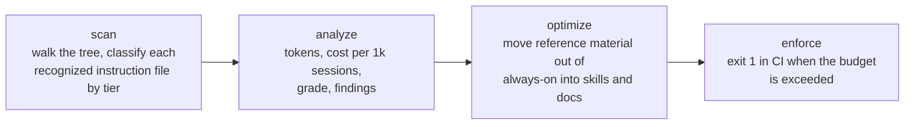

# agentdiet

<p align="center">
  <picture>
    <source media="(prefers-color-scheme: dark)" srcset="docs/assets/banner-dark.svg">
    <source media="(prefers-color-scheme: light)" srcset="docs/assets/banner-light.svg">
    
  </picture>
</p>

<p align="center">
  <a href="https://github.com/qansaid/agentdiet/releases/latest"></a>
  <a href="https://github.com/qansaid/agentdiet/actions/workflows/ci.yml"></a>
  <a href="LICENSE"></a>
  <a href="go.mod"></a>
  <a href="https://agentdiet.qansa.web.id"></a>
</p>

**See what your AI coding agent is configured to read before you type a single word, and cut it.**

`agentdiet` is a single static binary that discovers recognized AI agent
instruction files based on supported file conventions and estimates their context
consumption: per request, per 1,000 sessions, and against a budget you can
enforce in CI.

```bash
go install github.com/qansaid/agentdiet@latest
agentdiet
```

No runtime, no config file, no network call, no account.

<details open>
<summary><b>Real output</b> from a real repository, nothing staged</summary>

<br>

```text
$ agentdiet --top 4 /home/apps/src/claude-mem
agentdiet 0.1.1  ·  /home/apps/src/claude-mem
estimator: prose chars/4.5 + fenced-code chars/3.4, rounded up per segment (measured MAE 8% vs cl100k_base)

ALWAYS-ON   paid on every request, before you type
     442   0.22%    41 L  .claude/CLAUDE.md

ON-DEMAND   costs nothing until the agent opens it
   5,929   2.96%   439 L  plugin/skills/ccs-align/SKILL.md
   4,742   2.37%   241 L  claude-mem-cursor/skills/agent-cost-report/SKILL.md
   4,742   2.37%   241 L  claude-mem-grok-bot/skills/agent-cost-report/SKILL.md
   4,742   2.37%   241 L  cowork/skills/agent-cost-report/SKILL.md
       —      —  +56.4k  … 39 more files

CONFIG   not context; declares what the agent may call
     333  mcp          plugin/.mcp.json
      35  settings     .claude/settings.json

TOTAL      442 always-on tokens  (0.22% of a 200,000-token window)
GRADE      A  (budget 1,500)   on-demand surface: 76,533 tokens
COST       $1.33 per 1,000 sessions at $3.00 per 1M input tokens

FINDINGS
  · 18,140 tokens repeated across claude-mem-cursor/skills/agent-cost-report/SKILL.md ↔ claude-mem-grok-bot/skills/agent-cost-report/SKILL.md and 3 more
    → keep the text in one file and point at it from the others
  · 972 tokens repeated across openclaw/skills/make-plan/SKILL.md ↔ plugin/skills/make-plan/SKILL.md
    → keep the text in one file and point at it from the others
  · 425 tokens repeated across openclaw/skills/do/SKILL.md ↔ plugin/skills/do/SKILL.md
    → keep the text in one file and point at it from the others
  · 1 MCP server declared (mcp-search); tool schemas enter the prompt on connect
    → disable servers you do not use in this repo — schema cost scales with tool count

NOTE       76,533 tokens sit on demand — 173.2x the always-on tax, and free.
```

</details>

## How it works



One pass, no server round trip. The first two steps are a command; the last two
are decisions you make with its output.

## The problem it measures

Every agent runtime has a folder of files it loads **unconditionally**: `AGENTS.md`,
`CLAUDE.md`, `.cursorrules`, `copilot-instructions.md`. Nobody measures them. They
grow by accretion, a rule per incident and a table per architecture decision, and
then one day the agent is spending 12k tokens of attention on stale instructions
before it has read the question.

The same repositories also contain 80k tokens of skills and rules that cost
**nothing** until invoked. A tool that reports "your repo has 90k tokens of agent
config" collapses those two numbers and cannot tell you what to do. `agentdiet`
keeps them apart, because only one of them is a bill:

| Tier | When it loads | What to do with it |
| --- | --- | --- |
| **always-on** | every request, automatically | keep it ruthless; rules only |
| **scoped** | while editing that subtree | fine, it is proportional to the work |
| **on-demand** | only when the agent opens it | let it grow; this is where reference material belongs |
| **config** | declares tools/servers, not text | inventory the declarations; do not score their schema |

Measured rather than asserted: across 80 public repositories sampled through
GitHub code search, **16.0%** of all always-on tokens were duplicated
instructions, and the p90 repository spent 8,446 tokens before the prompt even
started. The population is not random, the token counts are estimates, and
duplication is counted per repository, not per session. Method, distribution and
the parts that cut against the story are in
[docs/field-report.md](docs/field-report.md).

## Install

```bash
# Go 1.22+
go install github.com/qansaid/agentdiet@latest
```

Prebuilt binaries for Linux, macOS and Windows (amd64/arm64) are on the
[releases page](https://github.com/qansaid/agentdiet/releases).

## Usage

```bash
agentdiet                     # audit the current repository
agentdiet path/to/repo        # audit somewhere else
agentdiet --json              # machine-readable report
agentdiet --badge             # shields.io endpoint document
agentdiet --max-tokens 4000   # exit 1 when always-on context outgrows 4k
agentdiet --top 20            # list more files per section
```

| Flag | Default | Meaning |
| --- | --- | --- |
| `--json` | off | emit the full report as JSON (stable keys, safe for dashboards) |
| `--badge` | off | emit a shields.io endpoint JSON document instead of the report |
| `--window` | `200000` | context window used for the share column |
| `--price` | `3.00` | USD per 1M input tokens, for the cost line |
| `--max-tokens` | `0` (off) | CI gate: exit 1 when always-on tokens exceed this |
| `--top` | `8` | max files listed per section |
| `--version` | | print version |

Exit codes: `0` ok · `1` over budget · `2` audit could not run.

## What it finds

Recognized without configuration:

<details>
<summary><b>File conventions</b> by tier</summary>

<br>

| Tier | Matched paths |
| --- | --- |
| **always-on** | `AGENTS.md`, `CLAUDE.md`, `GEMINI.md`, `JULES.md`, `.goosehints` at the repo root or in `.claude/` or `.codex/`; `AGENT.md`, `README.agent.md` at the root; `.cursorrules`, `.windsurfrules`, `.clinerules`, `.rules` at the root; `.github/copilot-instructions.md`; `SOUL.md`, `STYLE.md`, `INSTRUCTIONS.md`, `MEMORY.md` inside a Nakama profile workspace (a directory that also contains `SOUL.md`, since Nakama composes all four into the system prompt) |
| **scoped** | the same instruction filenames in any subdirectory |
| **on-demand** | `**/skills/**/SKILL.md`, `.cursor/rules/*.mdc`, `.claude/commands/**`, `.github/prompts/**`, `.github/instructions/**`, `.roo/rules/**`, `.continue/rules/**` |
| **config** | `.mcp.json`, `.cursor/mcp.json`, `.vscode/mcp.json`, `.claude/settings.json`, `.codex/config.toml` (MCP configuration inventory: declared server names are reported, schema tokens are not measured) |

</details>

`node_modules`, `vendor`, `dist`, `build`, `target`, virtualenvs, `.git` and other
dependency or build trees are skipped, so a vendored `AGENTS.md` is never counted
as your prompt.

### Findings

Beyond the totals, four checks produce the advice:

1. **Verbatim duplication**: the same paragraph in two or more files, with the
   duplicated content quantified. Actual savings depend on which files the
   runtime loads. This is the classic `CLAUDE.md`-is-a-stale-copy-of-`AGENTS.md`
   drift.
2. **Near-duplicate files**: one instruction file at least 60% contained in another.
3. **Oversize files**: a single always-on file above 3,000 tokens.
4. **MCP configuration inventory**: servers declared in the repo. Actual schema
   overhead depends on the runtime and the tools it connects; the audit does not
   measure it.

## Enforce it in CI

Repo-level action, failing the job when the always-on tax grows past a budget, so
it can only shrink on purpose:

```yaml
name: agent-context
on: [push, pull_request]
jobs:
  agentdiet:
    runs-on: ubuntu-latest
    steps:
      - uses: actions/checkout@v4
      - uses: qansaid/agentdiet@v1
        with:
          max-tokens: 4000
```

Or without the action:

```yaml
      - uses: actions/setup-go@v5
        with: { go-version: '1.22' }
      - run: go install github.com/qansaid/agentdiet@latest
      - run: agentdiet --max-tokens 4000
```

### Publish the score as a badge

`--badge` emits exactly the document shields.io expects from an *endpoint* badge.
Write it to a gist on every push and the badge updates itself:

```yaml
      - run: agentdiet --badge > badge.json
      - uses: schneegans/dynamic-badges-action@v1.7.0
        with:
          auth: ${{ secrets.GIST_TOKEN }}
          gistID: <your-gist-id>
          filename: badge.json
```

then in your README:

```markdown

```

## How tokens are counted

`agentdiet` does not embed a tokenizer. It estimates prose at 4.5 characters per
token and fenced code at 3.4, rounding each segment up.

Those divisors are measured, not guessed. On 137 real agent-configuration files
from five repositories, against `cl100k_base` via `tiktoken`:

| mean error | median | MAE | p10 / p90 | within ±15% |
| --- | --- | --- | --- | --- |
| +1.2% | +0.4% | 8.1% | −10.5% / +16.7% | 87% of files |

The sweep that chose them, and the corpus, are in
[docs/estimator.md](docs/estimator.md); `scripts/measure_estimator.py` re-runs it.

That is deliberate. A 2 MB vocabulary in the binary would buy precision nobody
acts on, cost 30 MB of download, and still be wrong for the next model's
tokenizer. The questions this tool answers are "400 tokens or 4,000" and "did it
grow by 30% this quarter", both of which sit far outside an 8% error bar. The
estimator is printed in every report, so the number is never a black box.

If you need exact counts for a specific model, run the file through that
tokenizer. `agentdiet` tells you which file is worth the trouble.

## Grades

Absolute always-on tokens, not a percentage of the window: a percentage makes
every real repository an A and the grade becomes decoration.

| Grade | Always-on tokens | Reading |
| --- | --- | --- |
| A | ≤ 1,500 | lean |
| B | ≤ 4,000 | normal for a serious repo |
| C | ≤ 8,000 | start moving reference material out |
| D | ≤ 16,000 | the agent is reading a document, not instructions |
| F | > 16,000 | most of the prompt is policy no one re-reads |

## Design notes

- **Tier over total.** The only number that costs money per request is the
  always-on one. Everything else is inventory.
- **Findings carry a fix.** "20,388 tokens duplicated" is a complaint;
  "keep the text in one file and point at it" is a task.
- **Skips are explicit.** Vendored and generated trees are excluded by name, not
  by heuristic, so the number is stable across machines.
- **No network, no telemetry, no config file.** One binary, one pass, one answer.

## Roadmap

<details>
<summary>Planned, not shipped</summary>

<br>

- [ ] `--since <ref>`: report the always-on delta introduced by a branch
- [ ] `.agentdietignore` for repos with generated instruction files
- [ ] exact tokenizer mode behind a build tag
- [ ] `--explain` to show which blocks a finding matched
- [ ] SARIF output so findings land in the code-scanning tab
- [ ] per-model window presets (`--model gpt-5`, `--model claude-4.5`)

</details>

## Contributing

Pick the door that fits:

- **A file your runtime loads is missing from the report.** Open the
  [file not detected](https://github.com/qansaid/agentdiet/issues/new?template=file-not-detected.yml)
  form and name the path. If you have twenty minutes, the fix is one case in
  `classify()` plus a fixture.
- **A question, or an idea that is not a bug yet.** Ask in
  [Q&A](https://github.com/qansaid/agentdiet/discussions/categories/q-a) or post
  it in [Ideas](https://github.com/qansaid/agentdiet/discussions/categories/ideas).
  Answers stay searchable instead of dying in a closed issue.
- **Your own numbers.** Post the ALWAYS-ON line and the grade you got in
  [Show and tell](https://github.com/qansaid/agentdiet/discussions/categories/show-and-tell).
  A convention that appears in twenty repositories gets support before one that
  appears in none.

[`good first issue`](https://github.com/qansaid/agentdiet/labels/good%20first%20issue)
marks the small ones. Read [CONTRIBUTING.md](CONTRIBUTING.md) before your first
pull request: `make test`, `gofmt`, one change per PR.

## License

MIT. See [LICENSE](LICENSE).
